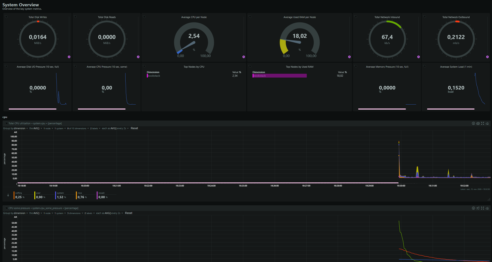

# BookStack – Vagrant

## O projektu

Pri tej nalogi sva z Vagrantom postavila virtualni računalnik z Ubuntu 24.04, na katerem teče aplikacija BookStack.

BookStack je spletna aplikacija za pisanje in urejanje dokumentacije. Uporabniki se lahko prijavijo, ustvarjajo strani in knjige ter imajo različne pravice za dostop do vsebine.

Cilj je bil, da se celotno okolje postavi čim bolj samodejno. Zato sva pripravila `Vagrantfile` in skripto `scripts/install.sh`, ki namesti potrebne programe in jih nastavi.

## Kaj sva uporabila

- **Vagrant in VirtualBox** – za ustvarjanje virtualnega računalnika
- **Ubuntu 24.04** – operacijski sistem
- **Nginx** – spletni strežnik
- **PHP 8.3** – za delovanje BookStacka
- **MariaDB** – za shranjevanje podatkov
- **Redis** – za predpomnjenje
- **Netdata** – za spremljanje porabe procesorja, pomnilnika in ostalih podatkov o sistemu
- **UFW** – požarni zid
- **Fail2ban** – za zaščito SSH pred večkratnimi neuspelimi prijavami

## Zagon

Za zagon potrebujemo Vagrant in VirtualBox.

V terminalu odpremo mapo projekta in zaženemo:

```bash
vagrant up
```

Ob prvem zagonu Vagrant ustvari virtualni računalnik in izvede skripto `scripts/install.sh`. Skripta namesti BookStack in ostale potrebne storitve.

Za povezavo z virtualnim računalnikom uporabimo:

```bash
vagrant ssh
```

Če spremenimo namestitveno skripto, jo lahko ponovno izvedemo z:

```bash
vagrant provision
```

## Dostop do aplikacije

BookStack je dostopen na:

https://localhost:8443

Nadzorna plošča Netdata pa na:

http://localhost:19999

Ker sva Vagrant poganjala na oddaljenem strežniku, sva za dostop iz svojega računalnika uporabila posredovanje vrat v VS Code.

## Varnost

Za HTTPS sva nastavila Nginx in ustvarila samopodpisan certifikat. Povezava je šifrirana, vendar brskalnik certifikatu privzeto ne zaupa, ker ni izdan pri zaupanja vrednem izdajatelju.

Z UFW sva omejila dostop do vrat virtualnega računalnika. Fail2ban spremlja neuspele prijave prek SSH in ob prevelikem številu poskusov začasno blokira naslov.

Geslo za podatkovno bazo se ob prvi namestitvi ustvari samodejno in shrani znotraj virtualnega računalnika, tako da ni zapisano neposredno v skripti.

BookStack ima tudi svoj sistem uporabnikov in pravic. Privzetemu administratorskemu računu sva po namestitvi spremenila geslo.

## Preverjanje delovanja

Po namestitvi sva preverila, da:

- se BookStack odpre v brskalniku in omogoča prijavo,
- deluje povezava z MariaDB,
- Redis deluje kot predpomnilnik,
- Nginx streže aplikacijo prek HTTPS,
- Netdata prikazuje podatke o delovanju sistema,
- sta UFW in Fail2ban aktivna.

Preverila sva tudi ponovno izvajanje skripte z `vagrant provision` in delovanje aplikacije po tem postopku.

## Posnetki zaslona

### BookStack


### Netdata



## Datoteke

- `Vagrantfile` – nastavitve virtualnega računalnika in posredovanja vrat
- `scripts/install.sh` – namestitev in konfiguracija aplikacije ter ostalih storitev
- `screenshots/` – posnetki zaslona delujoče aplikacije in nadzora sistema

## Opombe

Aplikacija je namenjena prikazu delovanja v lokalnem oziroma testnem okolju. Za javno uporabo bi bilo treba urediti še certifikat zaupanja vrednega izdajatelja in prilagoditi dostop do aplikacije.