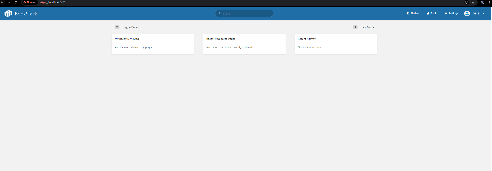
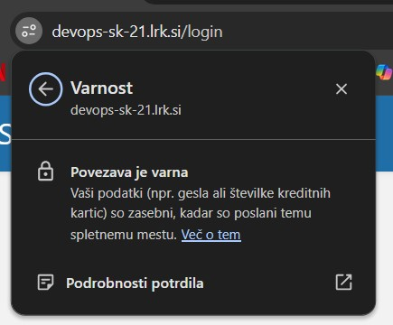

# BookStack – Vagrant in cloud-init

[BookStack](https://www.bookstackapp.com/) je spletna aplikacija za pisanje in urejanje dokumentacije.
Uporabniki se lahko prijavijo, ustvarjajo strani in knjige ter imajo različne pravice za dostop do vsebine.

Projekt avtomatično postavi virtualni računalnik z Ubuntu 24.04 in celotnim okoljem za BookStack.
Narejen je v dveh različicah:

1. [Vagrant](#1-vagrant)
2. [cloud-init](#2-cloud-init)

---

# 1. Vagrant

## O projektu

Z Vagrantom sva postavila virtualni računalnik z Ubuntu 24.04, na katerem teče aplikacija BookStack.

Cilj je bil, da se celotno okolje postavi čim bolj samodejno. Zato sva pripravila `Vagrantfile` in skripto
`scripts/install.sh`, ki namesti potrebne programe in jih nastavi.

## Kaj sva uporabila

- **Vagrant in VirtualBox** – za ustvarjanje virtualnega računalnika
- **Ubuntu 24.04** – operacijski sistem
- **Nginx** – spletni strežnik
- **PHP 8.3** – za delovanje BookStacka
- **MariaDB** – za shranjevanje podatkov
- **Redis** – za predpomnjenje
- **Netdata** – za spremljanje porabe procesorja, pomnilnika in ostalih podatkov o sistemu
- **UFW** – požarni zid
- **Fail2ban** – za zaščito SSH pred večkratnimi neuspelimi prijavami

## Zagon

Za zagon potrebujemo Vagrant in VirtualBox.

V terminalu odpremo mapo `vagrant` in zaženemo:

```bash
cd vagrant
vagrant up
```

Ob prvem zagonu Vagrant ustvari virtualni računalnik in izvede skripto `scripts/install.sh`.
Skripta namesti BookStack in ostale potrebne storitve.

Za povezavo z virtualnim računalnikom uporabimo:

```bash
vagrant ssh
```

Če spremenimo namestitveno skripto, jo lahko ponovno izvedemo z:

```bash
vagrant provision
```

## Dostop do aplikacije

- BookStack: `https://localhost:8443`
- Netdata: `http://localhost:19999`

Ker sva Vagrant poganjala na oddaljenem strežniku, sva za dostop iz svojega računalnika uporabila
posredovanje vrat v VS Code.

## Varnost

Za HTTPS sva nastavila Nginx in ustvarila samopodpisan certifikat. Povezava je šifrirana, vendar brskalnik
certifikatu privzeto ne zaupa, ker ni izdan pri zaupanja vrednem izdajatelju.

Z UFW sva omejila dostop do vrat virtualnega računalnika. Fail2ban spremlja neuspele prijave prek SSH in ob
prevelikem številu poskusov začasno blokira naslov.

Geslo za podatkovno bazo se ob prvi namestitvi ustvari samodejno in shrani znotraj virtualnega računalnika,
tako da ni zapisano neposredno v skripti.

BookStack ima tudi svoj sistem uporabnikov in pravic. Privzetemu administratorskemu računu sva po namestitvi
spremenila geslo.

## Preverjanje delovanja

Po namestitvi sva preverila, da:

- se BookStack odpre v brskalniku in omogoča prijavo,
- deluje povezava z MariaDB,
- Redis deluje kot predpomnilnik,
- Nginx streže aplikacijo prek HTTPS,
- Netdata prikazuje podatke o delovanju sistema,
- sta UFW in Fail2ban aktivna.

Preverila sva tudi ponovno izvajanje skripte z `vagrant provision` in delovanje aplikacije po tem postopku.

## Posnetki zaslona

### BookStack



### Netdata


## Datoteke

- `vagrant/Vagrantfile` – nastavitve virtualnega računalnika in posredovanja vrat
- `vagrant/scripts/install.sh` – namestitev in konfiguracija aplikacije ter ostalih storitev
- `vagrant/screenshots/` – posnetki zaslona delujoče aplikacije in nadzora sistema

## Opombe

Vagrant različica je namenjena prikazu delovanja v lokalnem oziroma testnem okolju. Javni dostop z veljavnim
certifikatom je urejen v cloud-init različici.

---

# 2. cloud-init

Datoteka `cloud-init/user-data.yaml` ob prvem zagonu čistega Ubuntu 24.04 strežnika postavi celoten stack
za BookStack. Skripta `cloud-init/launch.sh` VM ustvari in zažene z enim ukazom.

## Storitve

### BookStack
Aplikacija (PHP 8.3 + PHP-FPM) za pisanje dokumentacije v obliki knjig, poglavij in strani.
Dosegljiva na `https://localhost:9443` (lokalno) ali `https://devops-sk-21.lrk.si` (javno).


### Nginx
Reverse proxy s HTTPS. Pri javnem deployu uporablja veljaven **Let's Encrypt** certifikat
s samodejnim podaljševanjem, HTTP preusmeri na HTTPS in pošilja varnostne glave (HSTS ipd.).



### MariaDB
Podatkovna baza aplikacije. Posluša samo na localhost, geslo se generira ob deployu.

### Redis
Cache in shramba sej za BookStack, zaščiten z geslom.

### Prometheus
Zbira metrike sistema, Nginxa in Redisa (node, nginx in redis exporter).

### Loki + Alloy
Centralno zbiranje logov. Alloy bere loge Nginxa, BookStacka, fail2bana in systemd journala
(npr. SSH prijave) ter jih pošilja v Loki.

### Grafana
Prikazuje metrike iz Prometheusa in loge iz Lokija. Vira in dva dashboarda
(*BookStack stack* in *BookStack logi*) sta nastavljena samodejno.
Dosegljiva na `https://localhost:9443/grafana/` ali `https://devops-sk-21.lrk.si/grafana/`.


### Varnost
UFW (odprti samo porti 22, 80 in 443), fail2ban, SSH samo s ključem, samodejne varnostne posodobitve
in naključno generirana gesla, ki niso v gitu. Vse interne storitve poslušajo samo na localhost.

### Backup
Cron vsak dan naredi backup baze in naloženih datotek v `/var/backups/bookstack` in hrani zadnjih 7 dni.

## Deployment

Vse komponente se namestijo prek apt, Grafana, Loki in Alloy iz uradnega Grafana repozitorija.
Konfiguracijske datoteke so zapisane z `write_files` z `defer: true`, da se zapišejo šele po namestitvi
paketov. Na koncu `runcmd` zažene namestitveno skripto, ki nastavi bazo, aplikacijo, certifikat in storitve
ter na koncu preveri, ali vse deluje (`HEALTHCHECK OK`).


`launch.sh` prenese uradni Ubuntu cloud image, `user-data.yaml` zapakira v NoCloud seed ISO
in z njim zažene VM v VirtualBoxu.

Potrebno: VirtualBox in `cloud-image-utils` (`sudo apt install cloud-image-utils`).

```bash
cd cloud-init

# lokalno (self-signed certifikat)
./launch.sh up

# javno z Let's Encrypt certifikatom
PUBLIC_DOMAIN=devops-sk-21.lrk.si LE_EMAIL=ime@domena.si LE_STAGING=0 ./launch.sh up

# gesla (BookStack: admin@example.com, Grafana: admin)
./launch.sh ssh 'sudo cat /root/bookstack-secrets.env'

# brisanje VM
./launch.sh destroy
```

Za javni način mora biti promet s portov 80/443 strežnika preusmerjen v VM:

```bash
sudo iptables -t nat -A PREROUTING -i enp5s0 -p tcp --dport 80  -j REDIRECT --to-ports 9080
sudo iptables -t nat -A PREROUTING -i enp5s0 -p tcp --dport 443 -j REDIRECT --to-ports 9443
```

Deploy traja slabih **8 minut**.


https://github.com/devops-fri-26/sk-21-virtualization/blob/cloud-init/docs/screenshots/deployVid.mp4
