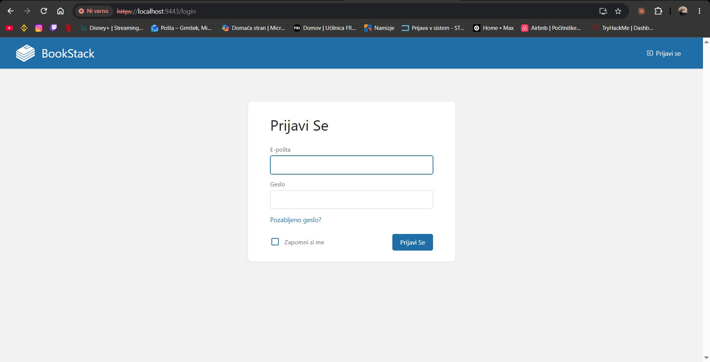
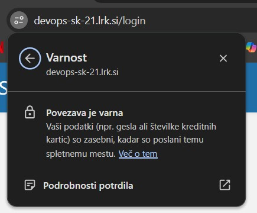
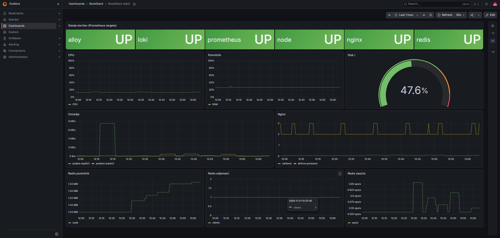
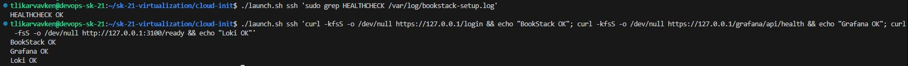
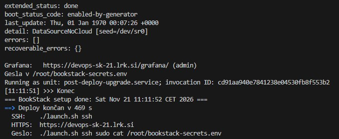

# BookStack – cloud-init

Ta mapa vsebuje cloud-init različico projekta. Datoteka `user-data.yaml` ob prvem zagonu čistega
Ubuntu 24.04 strežnika postavi celoten stack za [BookStack](https://www.bookstackapp.com/),
odprtokodno platformo za dokumentacijo in wiki. Skripta `launch.sh` VM ustvari in zažene z enim ukazom.

## Storitve

### BookStack
Aplikacija (PHP 8.3 + PHP-FPM) za pisanje dokumentacije v obliki knjig, poglavij in strani.
Dosegljiva na `https://localhost:9443` (lokalno) ali `https://devops-sk-21.lrk.si` (javno).



### Nginx
Reverse proxy s HTTPS. Pri javnem deployu uporablja veljaven **Let's Encrypt** certifikat
s samodejnim podaljševanjem, HTTP preusmeri na HTTPS in pošilja varnostne glave (HSTS ipd.).



### MariaDB
Podatkovna baza aplikacije. Posluša samo na localhost, geslo se generira ob deployu.

### Redis
Cache in shramba sej za BookStack, zaščiten z geslom.

### Prometheus
Zbira metrike sistema, Nginxa in Redisa (node, nginx in redis exporter).

### Loki + Alloy
Centralno zbiranje logov. Alloy bere loge Nginxa, BookStacka, fail2bana in systemd journala
(npr. SSH prijave) ter jih pošilja v Loki.

### Grafana
Prikazuje metrike iz Prometheusa in loge iz Lokija. Vira in dva dashboarda
(*BookStack stack* in *BookStack logi*) sta nastavljena samodejno.
Dosegljiva na `https://localhost:9443/grafana/` ali `https://devops-sk-21.lrk.si/grafana/`.



### Varnost
UFW (odprti samo porti 22, 80 in 443), fail2ban, SSH samo s ključem, samodejne varnostne posodobitve
in naključno generirana gesla, ki niso v gitu. Vse interne storitve poslušajo samo na localhost.

### Backup
Cron vsak dan naredi backup baze in naloženih datotek v `/var/backups/bookstack` in hrani zadnjih 7 dni.

## Deployment

Vse komponente se namestijo prek apt, Grafana, Loki in Alloy iz uradnega Grafana repozitorija.
Konfiguracijske datoteke so zapisane z `write_files` z `defer: true`, da se zapišejo šele po namestitvi
paketov. Na koncu `runcmd` zažene namestitveno skripto, ki nastavi bazo, aplikacijo, certifikat in storitve
ter na koncu preveri, ali vse deluje (`HEALTHCHECK OK`).



`launch.sh` prenese uradni Ubuntu cloud image, `user-data.yaml` zapakira v NoCloud seed ISO
in z njim zažene VM v VirtualBoxu.

Potrebno: VirtualBox in `cloud-image-utils` (`sudo apt install cloud-image-utils`).

```bash
cd cloud-init

# lokalno (self-signed certifikat)
./launch.sh up

# javno z Let's Encrypt certifikatom
PUBLIC_DOMAIN=devops-sk-21.lrk.si LE_EMAIL=ime@domena.si LE_STAGING=0 ./launch.sh up

# gesla (BookStack: admin@example.com, Grafana: admin)
./launch.sh ssh 'sudo cat /root/bookstack-secrets.env'

# brisanje VM
./launch.sh destroy
```

Za javni način mora biti promet s portov 80/443 strežnika preusmerjen v VM:

```bash
sudo iptables -t nat -A PREROUTING -i enp5s0 -p tcp --dport 80  -j REDIRECT --to-ports 9080
sudo iptables -t nat -A PREROUTING -i enp5s0 -p tcp --dport 443 -j REDIRECT --to-ports 9443
```

Deploy traja slabih **8 minut**.



https://github.com/devops-fri-26/sk-21-virtualization/blob/cloud-init/docs/screenshots/deployVid.mp4
